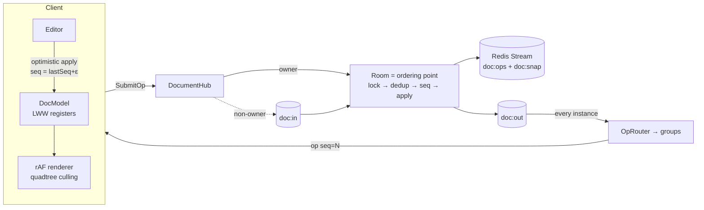

# CollabCanvas

A Figma-like multiplayer canvas, built as a study project: real-time
co-editing of shapes on an infinite board — the way Figma actually
does it, not the way textbooks say "use OT or CRDTs".

**Stack:** .NET 8 + SignalR · Redis (journal + pub/sub + presence
lifecycle) · React + TypeScript + Canvas 2D · docker-compose.

## How it works — one picture



The short version:

- **No OT, no full CRDT.** A central room sees every write and
  assigns `seq` — "last write wins" where "last" means "last to
  reach the server". Each object property is an LWW register, so
  apply is idempotent and order-agnostic by construction.
- **Durability:** every op is journaled to a Redis Stream inside the
  room lock, before broadcast; snapshots every 100 ops. Restart =
  snapshot + replay tail, with the retry-dedup index rebuilt from
  the journal itself.
- **Optimistic UI:** local ops apply instantly with a fractional
  temp seq — the server echo always wins. Reconnect replays pending
  ops over fresh state (rebase), dedup absorbs the ones that landed.
- **Scale-out:** owner-per-doc via a Redis claim; submits to
  non-owners travel pub/sub to the owner. Advisory claim — the
  honest split-brain window is documented in `docs/architecture.md` §21.
- **Presence** is a separate ephemeral channel: TTL + sweeper +
  disconnect fast-path, never journaled.

## Run it

```bash
docker compose up --build     # api :8090 · web :3100 · redis :6380
```

Or dev-mode: `dotnet run --project src/CollabCanvas.Api` and
`cd web && npm i && npm run dev` (vite :5173, proxied to :8090).

Open two browsers → **Join demo** → draw in one, watch the other.
Remote cursors, reconnect catch-up, and the 10k-object stress button
are all live.

## What's proven

| Claim | Where |
| --- | --- |
| Apply is idempotent + converges under shuffle/dup delivery | `DocumentApplyTests`, `ChaosTests` |
| Server seq is gapless under concurrent submits | `RoomTests` (Parallel.For) |
| Client retry after *server restart* still dedups | `PersistenceTests` |
| Snapshot + tail recovery, truncated journal | `PersistenceTests` |
| Kill-mid-stream loses exactly the durable prefix | `ChaosTests` |
| Presence: TTL expiry, rate-limited fanout, disconnect path | `PresenceTests` |
| Fractional index: 500 inserts, no precision exhaustion | `FractionalIndexTests` |

**Not proven automatically:** 10k @ 60fps is verified by eye against
the stats overlay (`drawn`/`drawMs`/`fps`) — no perf harness in CI.
Redis-backed paths (Stream journal, pub/sub transport, owner claims)
are exercised by smoke, not unit tests — everything behind
`IOpJournal`/`IRoomTransport` is tested on in-memory twins.

## Layout

```
src/CollabCanvas.Core   pure logic: Document (LWW), Room (ordering),
                        FractionalIndex, journal/transport contracts
src/CollabCanvas.Api    transport: DocumentHub, Redis journal +
                        pub/sub, presence sweeper, health
web/                    React shell; DocModel mirror, renderer,
                        quadtree, editor, session
docs/architecture.md    the design doc — read §11 (failure map) first
docs/diagrams/mmd/      mermaid sources, synced per stage
```

## Honest limitations (MVP)

- Franken-merge: two users editing one object get x-from-A +
  w-from-B. Legal under per-prop LWW — same as Figma.
- Text is LWW on the whole string (no co-typing).
- Owner claims have no fencing: a stalled owner + reclaim can fork
  seq briefly (§21.1). pub/sub is at-most-once (§21.3).
- No auth, no undo, no room eviction.
```
