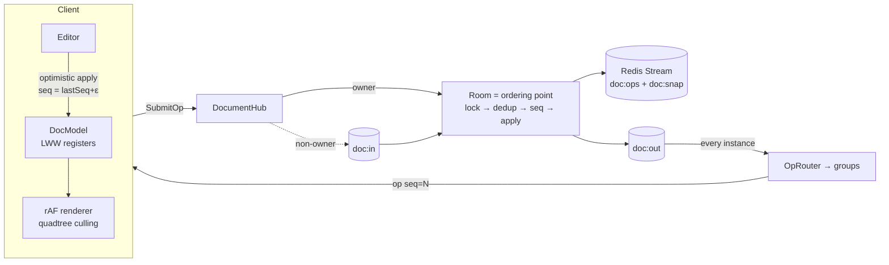

# CollabCanvas

A Figma-like multiplayer canvas, built as a study project: real-time
co-editing on an infinite board — the way Figma actually does it, not
the way textbooks say "use OT or CRDTs".

**Stack:** .NET 8 + SignalR · Redis · React + TypeScript + Canvas 2D ·
docker-compose · Node 24 live test bot · xUnit.

## Stack — every choice justified

| Choice | Why it's here | Rejected |
| --- | --- | --- |
| **.NET 8 + SignalR** | One stateful room process IS the ordering point — SignalR gives groups, reconnect and invoke/ack without a hand-rolled WS layer | Raw WebSocket plumbing; a separate gateway service |
| **Redis (one dep, four roles)** | Stream = op journal with MAXLEN · keys = snapshots/sessions/blobs · pub/sub = cross-instance transport · hashes/sets = memberships, links, comments | Postgres journal (write amplification), NATS/Kafka (a broker to babysit for one channel) |
| **LWW + central seq** | A server that sees every write makes merge trivial: per-prop last-writer-wins converges by construction | OT / full CRDT — machinery for a problem the central server already removed |
| **Fractional index (base-62)** | Deterministic z-order merge on every replica; strings never exhaust precision | float64 midpoints (die after ~50 inserts), integer reindex storms |
| **Canvas 2D + quadtree** | 10k objects must not become 10k DOM nodes; cull + hit-test cost O(visible), not O(n) | SVG/DOM rendering; linear hit scans |
| **Server sessions, no JWT** | Revocation per request — logout/revoke kills a live socket on the next op; bcrypt for passwords | JWT (can't revoke without a denylist), self-rolled crypto |
| **Node 24 bot** | Native fetch/WebSocket + real `@microsoft/signalr` — the wire contract verified live, no browser needed | JSDOM tests that prove nothing about the wire |
| **docker-compose** | Three services, one command, reproducible | k8s — ops overhead for zero gain at this scale |

Deliberately **not** in the stack: a CRDT library, an ORM abstraction
layer, S3/blob service (Redis is the honest MVP tier), a build
pipeline beyond `dotnet`/`vite`. Everything added had to answer
*what breaks without it*.

## How it works — one picture



The short version:

- **No OT, no full CRDT.** A central room sees every write and
  assigns `seq` — "last write wins" where "last" means "last to
  reach the server". Each object property is an LWW register, so
  apply is idempotent and order-agnostic by construction.
- **Durability:** every op is journaled to a Redis Stream inside the
  room lock, before broadcast; snapshots every 100 ops. Restart =
  snapshot + replay tail; the retry-dedup index is rebuilt from the
  journal itself.
- **Optimistic UI:** local ops apply instantly with a fractional
  temp seq — the server echo always wins. Reconnect replays pending
  ops over fresh state (rebase); dedup absorbs the ones that landed.
- **Scale-out:** owner-per-doc via a Redis claim; submits to
  non-owners travel pub/sub to the owner. The split-brain window is
  documented, not hidden (`docs/architecture.md` §21).
- **Presence** is a separate ephemeral channel: TTL + sweeper +
  disconnect fast-path, never journaled.

## What it does

- **Editing:** select/move/resize (8 handles, rotated, aspect-lock),
  rotate, multi-select group resize/rotate, align/distribute,
  z-order, duplicate, copy/paste, snap-to-grid, undo/redo
  (compensating ops), lock, flat group tags + isolation mode
  (dblclick into a group).
- **Content:** rect/ellipse/line/text/path/image — images upload to
  a per-doc blob store (Lua-atomic quota, snapshot-driven GC).
- **Text:** inline editing with live co-typing (throttled LWW
  patches over the wire — a documented reversal of an earlier
  "commit on blur" decision).
- **Collab:** remote cursors + colored selection frames, presence
  names resolved server-side, doc-level comments (separate from
  document state — conversation, not LWW).
- **Sharing:** sessions + roles (owner/admin/editor/viewer),
  bearer links with optional expiry, member management, ownership
  transfer, password change with cross-session revocation.
- **Lifecycle:** document list, rename, reversible delist, and
  owner-only hard destroy — tombstoned so a deleted doc can't
  resurrect through the legacy-open path. Deletes wipe journal,
  members, links, comments and blob bytes.
- **Input:** pointer-event unification — mouse/pen/finger, two-finger
  pinch zoom+pan, responsive narrow-screen layout.

## Run it

```bash
docker compose up --build     # api :8090 · web :3100 · redis :6380
```

Or dev-mode: `dotnet run --project src/CollabCanvas.Api` and
`cd web && npm i && npm run dev` (vite :5173, proxied to :8090).

Open two browsers → join a doc → draw in one, watch the other.
Remote cursors, reconnect catch-up, comments, share links and the
10k-object stress button are all live.

## What's proven

| Claim | Where |
| --- | --- |
| Apply is idempotent + converges under shuffle/dup delivery | `DocumentApplyTests`, `ChaosTests` |
| Server seq is gapless under concurrent submits | `RoomTests` (Parallel.For) |
| Retry after *server restart* still dedups | `PersistenceTests` |
| Snapshot + tail recovery, truncated journal | `PersistenceTests` |
| Kill-mid-stream loses exactly the durable prefix | `ChaosTests` |
| Presence: TTL expiry, rate-limited fanout, disconnect path | `PresenceTests` |
| Fractional index: 500 inserts, no precision exhaustion | `FractionalIndexTests` |
| Auth/roles/links/comments/destroy/blob-GC wire behavior | `tests/bot.mjs` — **115 live checks** |

**Measured (`tests/perf.mjs`, Node 24):** 10k objects — SceneIndex
build 16ms, `objects()` scan 8ms, viewport cull <1ms, hit-test
<0.1ms; op submit→echo RTT p50 1.1ms (n=200).

**Honest edges:** 60fps is eyeballed (canvas draw calls can't run
headless); the blob quota is atomic but Redis is MVP storage;
whole-string LWW for text, no per-char CRDT; advisory owner claims,
no fencing; `docker-compose` scale, not k8s.

## Layout

```
src/CollabCanvas.Core   pure logic — Document (LWW), Room, journal
                        contracts. Zero infra references (audited).
src/CollabCanvas.Api    transport: DocumentHub, Redis stores,
                        Endpoints/{Auth,Doc,Blob}, presence
web/                    React shell; DocModel mirror, renderer,
                        quadtree, editor, session — layered, no cycles
docs/architecture.md    the design doc — read the failure map first
docs/diagrams/mmd/      mermaid sources, synced per stage (12 files)
tests/                  xUnit suite + tests/bot.mjs live e2e
tests/perf.mjs          index/cull/RTT harness
```

## How it was built

Review-driven, not prompt-driven. An AI agent (Devin) wrote all the
code; every stage arrived with a design note, an honest risk list and
a review checklist — then a human reviewed every diff, predicted
failure modes before each run, and made the design calls (flat group
tags vs nesting, Redis blobs vs S3, lazy vs swept link expiry,
whole-string LWW vs CRDT). The process caught real bugs: a destroyed
doc resurrecting through the legacy-open path, an Escape-revert
diverging replicas, a quota check-then-act race. Decisions and their
reversals are logged in the design journal, and a coding-rules file
bans the machine-smell patterns found along the way.

The point of the project: not "ship a canvas", but build the
judgment to open any module and answer *"what breaks here first
under load or failure — and why"*.

## Honest limitations (MVP)

- Franken-merge: two users editing one object get x-from-A +
  w-from-B. Legal under per-prop LWW — same as Figma.
- Text co-typing is whole-string LWW — last writer wins, no
  per-character CRDT.
- Redis blob storage is the MVP tier; S3/disk migration is deferred
  until scale justifies it.
- Owner claims are advisory — a stalled owner + reclaim can fork
  seq briefly (documented, §21.1); pub/sub is at-most-once.
