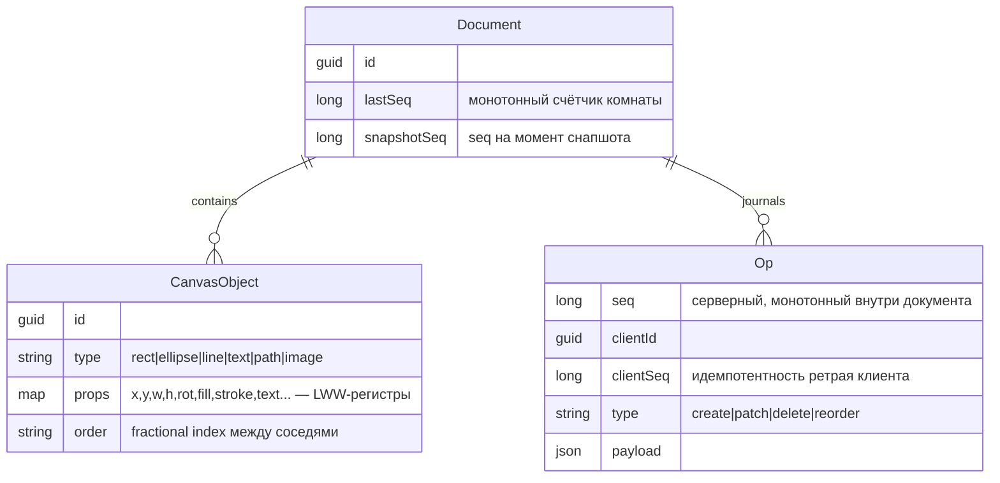
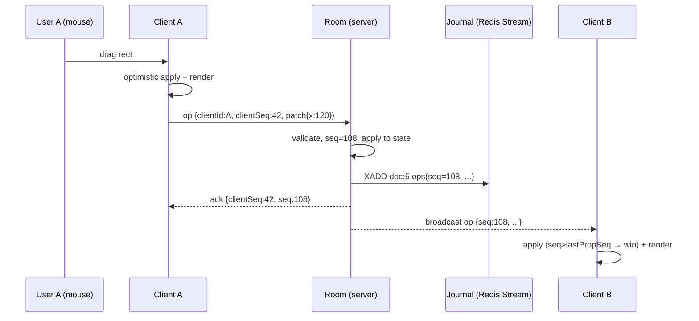
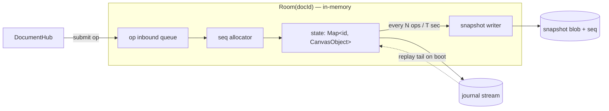
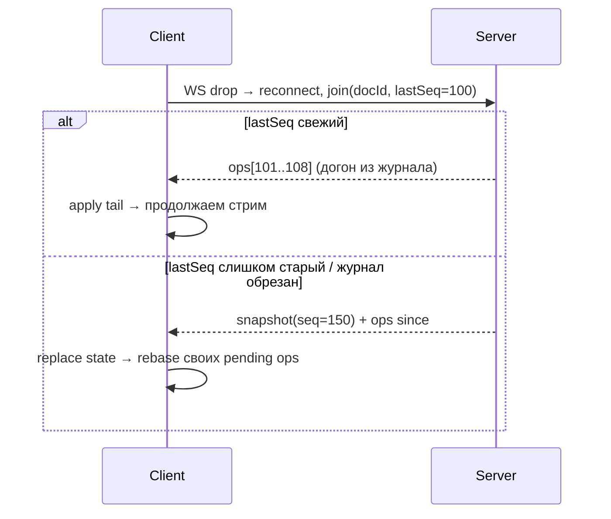

# CollabCanvas — архитектура (T-1)

Дизайн-док для ревью юзером. Читать с чеклистом
`docs/guides/review_checklists.md` под рукой. Gate-вопросы — в
конце. Источник истины о «как у настоящих» — блоги Figma
(`figma.com/blog` — multiplayer, reliability, ordered sequences).

---

## 1. Требования

### Функциональные (MVP)

- Документ = канва с объектами типов: **rect, ellipse, line, text,
  freehand-path, image** (заглушка-URL). Z-order между объектами.
- Операции: создать, двигать, ресайз, повернуть, менять свойства
  (fill/stroke/fontSize/текст), удалять, менять порядок.
- Мультиплеер: несколько юзеров на одном документе, правки видны
  в реальном времени обеим сторонам.
- Presence: живые курсоры + выделения других юзеров (эфемерно).
- Персистентность: документ переживает рестарт сервера; reconnect
  клиента догоняет пропущенное.
- Viewport: pan + zoom; выбор и редактирование мышью.

### Stretch (не MVP, но дизайн не должен мешать)

- Комментарии, undo/redo, version history (журнал уже даёт),
  экспорт в PNG, настоящее co-editing текста.

### Нефункциональные (критерии, которые ревьюер может проверить)

| Метрика | Цель |
| --- | --- |
| Рендер | 60fps на 10k объектов (culling + dirty regions) |
| Op latency (свой→чужой экран) | < 100 мс при локальном запуске |
| Потеря ops при краше сервера | ≤ 1 с (как у Figma: journal + checkpoint) |
| Потеря presence | допустима — эфемерный канал |
| Конвергентность | все реплики → одинаковое состояние, детерминировано |
| Юзеров на документ | десятки (не тысячи — MVP) |

---

## 2. Стек (зафиксировано в PLAN.md)

ASP.NET Core (net8.0; net10 при установке SDK) + SignalR · Redis ·
React + TS + Vite + Canvas 2D API · docker-compose.

---

## 3. Ключевая идея: центральный сервер снимает сложность

Спека предлагала «OT или CRDTs». Смотрим, что делает реальная
Figma — и почему это правильно для нас:

- **OT** нужен, когда два юзера редактируют *один текст* посимвольно
  — операции надо трансформировать друг относительно друга,
  сохраняя инварианты. У нас канва объектов, а не совместный
  текстовый документ → инвариантов трансформации почти нет.
- **Полный CRDT** нужен для merge *без* центрального авторитета
  (peer-to-peer, оффлайн-first). Он платит за это метаданными:
  векторные часы, tombstone'ы, RGA-последовательности.
- **У Figma есть центральный сервер** — один процесс на открытый
  документ, который видит *все* записи и назначает порядок.
  Это схлопывает задачу: «last write wins», где «last» = последний
  дошедший до сервера. Ни timestamp'ов, ни векторных часов —
  серверный `seq` решает всё.

**Итоговая модель (как у Figma):**

- Каждое свойство объекта = **LWW-регистр**; winner = op с большим
  серверным `seq`.
- Порядок детей (z-order) = **fractional indexing** — дробный ключ
  между соседями, бесконечная точность, детерминированное
  строковое сравнение.
- Состояние документа живёт **в памяти комнаты** (процесс-владелец)
  + append-only **журнал опов** + периодические **снапшоты**.
- Presence — отдельный **эфемерный** канал, в журнал не пишется.

---

## 4. Модель данных

**Формат op'ов** (то, что летит по проводу и пишется в журнал):

| Op | Payload | Apply-семантика |
| --- | --- | --- |
| `create` | `{objectId, type, props, order}` | add если id ещё нет |
| `patch` | `{objectId, props{...}}` | per-prop: `props[k] = v` если op.seq > prop.lastSeq |
| `delete` | `{objectId}` | tombstone; последующие patch к объекту игнорятся |
| `reorder` | `{objectId, order}` | LWW по seq, как обычное свойство |

Два инварианта, которые тесты обязаны доказать:

1. **Идемпотентность**: `apply(apply(s, op), op) == apply(s, op)`.
2. **Детерминизм**: одна и та же упорядоченная серия ops даёт
   одинаковое состояние на любой реплике (никаких `Date.now()`
   или `Dictionary`-порядка в merge).

---

## 5. Поток операции — happy path

Что здесь важно ревьюеру:

- Оптимистичный apply на клиенте — мгновенный отклик; сервер может
  **переупорядочить** его относительно чужих ops → клиент обязан
  уметь «откатить и переиграть» (rebase своих неподтверждённых
  ops поверх серверного состояния).
- `clientId + clientSeq` — ключ идемпотентности клиентского
  ретрая: сервер видит повтор того же op → ack, но не применяет
  дважды.

---

## 6. Комната — внутренности

Один процесс-владелец на документ (MVP: один инстанс API — точка
упорядочивания тривиальна; scale-out — T-10, там своя история).

---

## 7. Реконнект и догон

Граница, которую надо уметь назвать: ops, сделанные клиентом
**пока был оффлайн**, не подтверждены сервером — стратегия MVP:
rebase поверх нового состояния (локальные pending ops шлются
заново как новые). Конфликтная семантика — та же LWW, вручную
ничего не мерджим.

---

## 8. Presence — эфемерный канал

- Сообщения `{cursor:{x,y}, selection:[ids], color}` — **не** в
  журнале, **не** с seq. Замещение: новее вытесняет старое per-user.
- Heartbeat: клиент шлёт раз в ~2с (throttle до ~10/с на движение);
  сервер помечает юзера живым; TTL ~10с → истёк = курсор исчезает
  у всех.
- Fanout: внутри комнаты, in-memory (MVP); pub/sub — в T-10.

Почему не журнал: presence не переживает reconnect и не нужен
replay — писать его в durable log = мусор и тормоза восстановления.

---

## 9. Персистентность

- **Журнал**: Redis Stream `doc:{id}:ops` (`XADD` на каждый op;
  `MAXLEN ~ N` — грубое усечение, старое живёт в снапшотах).
- **Снапшоты**: `doc:{id}:snap` = сериализованный state + seq.
  Триггер: каждые K ops ИЛИ каждые T сек при активности
  (как у Figma 30–60с).
- **Recovery**: `load snap → XREVRANGE(seq>snapSeq) → apply tail`.
- **Честное ограничение**: Redis persistence = AOF everysec → до
  ~1с журнала при убийстве процесса теряем (наша цель — та же,
  что у Figma). Postgres append-таблица — более durable
  альтернатива, стоит в развилках ниже.

---

## 10. Дизайн-развилки (что выбрано и когда альтернатива лучше)

| Ось | Выбор | Альтернатива | Когда альтернатива выигрывает |
| --- | --- | --- | --- |
| Sync-модель | LWW-регистры + server seq | OT · полный CRDT | OT — посимвольный co-text; CRDT — p2p/оффлайн-first без сервера |
| Гранулярность op | per-property patch | целый объект / intent-op (moveBy) | intent-op сохраняет «намерение» при конфликте (двое двигают — сумма сдвигов), но нужна семантика каждого intent'а |
| Порядок детей | fractional index | integer reindex / linked-list | reindex прост, но конфликтует при параллельных вставках |
| Журнал | Redis Streams | PG append-table · Kafka | PG — строже durability, уже был бы в стеке; Kafka — для firehose-масштаба |
| Владение комнатой | in-memory процесс | stateless + Redis lock | stateless масштабируется, но теряет «одну точку порядка» → нужен leader election |
| Presence | in-memory fanout + TTL | Redis hash+TTL / pub/sub | Redis — при scale-out на N инстансов |
| Рендер | Canvas 2D + dirty regions | SVG DOM · WebGL (PixiJS) | SVG мёртв на 10k нод; WebGL — если 100k+ объектов или сложные эффекты |
| Hit-test | QuadTree | R-tree / uniform grid / линейный скан | grid проще при равномерном размере; scan ок <1k объектов |
| Транспорт | SignalR (WS) | голый WebSocket · WebRTC DC | WebRTC — p2p мышечный канал, но теряешь серверный порядок |
| Текст co-edit | LWW целой строки | Yjs/RGA | Yjs — если «двое печатают в один textbox» станет требованием |

---

## 11. Карта отказов (где дубль, где потеря)

| Точка | Дубль возможен? | Потеря возможна? | Механизм |
| --- | --- | --- | --- |
| Клиентский ретрай op | да — по сети | нет | dedup по `clientId+clientSeq` |
| Broadcast после apply | да — re-delivery pub/sub (T-10) | до журнала — нет | клиент игнорит `seq <= last` |
| Сервер: apply→journal→broadcast | частичный крах между шагами | журнал — истина: apply без journal = фантом в памяти, сотрётся рестартом | порядок: journal→broadcast |
| Снапшот во время op-потока | snapshot содержит replayed ops | нет — replay идемпотентен | snapshot хранит свой seq |
| Офлайн-правки клиента | rebase = «новые» ops | да — конфликтующие правки сливаются LWW'ем (документировано) | pending-очередь + resubmit |
| Presence | старый апдейт после нового | флейпинг курсора | per-user замещение, TTL |

---

## 12. Честные риски и ограничения MVP

1. **Franken-merge**: два юзера трогают один объект одновременно —
   двигает A, ресайзит B → итоговый объект = x от A + w от B.
   Легально по LWW, но выглядит «странно». Реальная Figma живёт с
   этим — мы тоже (задокументировать).
2. **Текст**: LWW на целую строку — двое печатают в одном textbox,
   выживает один. Принято для MVP; Yjs — отдельной стадией если
   понадобится.
3. **Один инстанс**: комната в памяти — рестарт API = все комнаты
   восстанавливаются из snap+journal (до ~1с потерь) + все клиенты
   реконнектятся разом (storm → jitter backoff).
4. **Redis durability**: AOF everysec ≈ ≤1с журнала.
5. **Нет undo**: LWW не «отменяет» — нужна инверсия ops
   (op-log → compensating op). Stretch.
6. **Auth нет**: кто угодно с docId редактирует. MVP — анонимные
   сессии с clientId.

---

## 13. Gate-вопросы (T-1 не закрыт без ответов юзера)

1. Почему серверный `seq` делает ненужными timestamp'ы и векторные
   часы? Что бы сломалось, убери центральный сервер?
2. В §5 — где в этом пути op может **продублироваться** и где
   **потеряться**? Сверься с §11 — нашёл ли ты все строки?
3. Клиент прислал op, сервер упал между journal и broadcast.
   Что видят другие клиенты после рестарта — и почему это
   приемлемо?
4. Franken-merge (§12.1): придумай сценарий, где он реально
   раздражает юзера. Какой op-гранулярностью его можно было бы
   смягчить?
5. Чем fractional index принципиально лучше `position int` с
   перенумерацией — назови конфликт, который второй не переживает.
6. Presence не в журнале — ок. А *выделение* юзера (чужая рамка на
   объекте) — тоже эфемерное? А если юзер ушёл, а его выделение
   висит — чей TTL это лечит?

---

## 14. Apply-семантика (T-3, реализовано)

Файл: `src/CollabCanvas.Core/Model/Document.cs`. Диаграмма:
`docs/diagrams/mmd/doc-model.mmd`.

**Модель:** каждое свойство объекта — LWW-регистр `(objId, prop) →
(value, seq)`, включая служебные `_kind` и `_z`. Существование
объекта — тоже LWW: `createSeq` vs `deleteSeq`; виден ⇔
`createSeq > deleteSeq`.

**Следствия, проверенные тестами (`DocumentApplyTests`, 6 шт):**

| Свойство | Механизм |
| --- | --- |
| Идемпотентность | повторный apply: `seq <= propSeq` → no-op |
| Конвергенция | seq — полный порядок; shuffle ops → тот же `Snapshot()` |
| Patch ≠ воскрешение | patch пишет регистры, но видимость — только create>delete |
| Воскрешение | только Create с seq > deleteSeq |
| Детерминизм | нет timestamp/float-compare/dict-order — только целый seq и сортировка (z, id) |

**Честные края:** patch к несуществующему объекту всё равно пишет
регистры (правильно — при позднем create с меньшим seq эти значения
проиграют); franken-merge по §12.1 стоит как был — гранулярность
per-prop.

---

## 15. Комната и упорядочивание (T-4, реализовано)

Файлы: `Core/Room/Room.cs`, `Api/Hubs/DocumentHub.cs`. Диаграмма:
`docs/diagrams/mmd/seq-flow.mmd`.

**Разделение:** `Room` — чистая логика (dedup → seq → apply →
journal) под одним `lock`; хаб — тонкий адаптер: join → ops-since,
submit → broadcast группе + ack автору. Тесты бьют Room напрямую,
без SignalR.

**Ключевые решения:**

| Место | Решение | Почему |
| --- | --- | --- |
| seq | назначает комната под локом — клиенты seq не трогают | полный порядок бесплатно внутри процесса |
| dedup ретрая | `(clientId, clientSeq)` → исходный seq из `_ackIndex` | клиентский offline-buffer шлёт pending заново |
| broadcast | `Clients.Group` включая автора | автор мирит optimistic-apply по эхо-seq (T-9) |
| journal | in-memory `List`, seq-ordered | персистентность = T-5; рестарт сейчас теряет всё — осознанно |
| snapshot в join | пока `null` — журнал полный и мал | снапшоты нужны, когда журнал урезан (T-5) |

**Честные края:** комнатам нет eviction — пустые комнаты копятся
(T-10); `_lastClientSeq` принимает клиентские дырки молча
(out-of-order submit внутри клиента — его проблема, серверу
безразличен порядок clientSeq). `_journal[seq-1]` из T-4 заменён на
словарь seq→op — журнал теперь урезаемый (§16).

---

## 16. Журнал, снапшоты, восстановление (T-5, реализовано)

Файлы: `Core/Journal/IOpJournal.cs` (+ `InMemoryOpJournal`),
`Api/Journal/RedisOpJournal.cs`, `Room.cs` (recovery + join-ветки),
`Document.Restore`. Диаграмма: `docs/diagrams/mmd/recovery.mmd`.

**Контракт `IOpJournal`** (sync — точка упорядочивания и так лок,
append идёт внутри него после apply и до broadcast):
`Append` / `ReadSince(seq)` / `LoadSnapshot` / `WriteSnapshot` /
`FirstSeq` (база журнала — урезание MAXLEN двигает её вперёд,
читается live на каждом join).

**Recovery (конструктор Room):** snapshot → `Document.Restore`
(регистры получают `propSeq=snapSeq` — ops ≤ snapSeq проигрывают LWW
бесплатно) → replay ВСЕГО выжившего журнала (ops ≤ snapSeq — no-op,
но нужны в `_ops` для join-хвостов) → rebuild `_ackIndex` и
`_lastClientSeq` прямо из journaled ops — **dedup переживает
рестарт бесплатно**: ретрай клиента после рестарта возвращает
исходный seq (тест `Restart_ClientRetry_StillDeduped`).

**Join-ветки:** `FirstSeq <= lastSeq <= room.LastSeq` → хвост ops;
иначе (ниже базы журнала ИЛИ в будущем) → `Document.Snapshot()` +
ops с snapSeq. «Клиент в будущем» = сервер потерял данные → честный
ответ — полное состояние, а не молчаливый пробел.

**Redis-мapping:** stream `doc:{id}:ops` (XADD, MAXLEN ~10k
approximate), snap `doc:{id}:snap` = `{seq,json}`. Stream-id ≠ op-seq —
`ReadSince` фильтрует по полю `Seq` после десериализации.

**Snapshot-триггер:** каждые `Room.SnapshotEveryOps = 100` ops,
внутри того же лока — гонки «snapshot vs ops» нет, снапшот всегда
консистентный срез.

**Честные края:**

1. `RedisOpJournal` — **fail-open**: любая Redis-ошибка → no-op,
   комната деградирует до in-memory persistence (ops живут, рестарт
   теряет). Альтернатива «фейлить Submit» превратила бы Redis-блип в
   полную остановку редактирования. Наблюдаемо через `/health
   → degraded`. Это осознанный разрыв at-least-once — как и AOF
   everysec, но шире (любой сбой записи, не только kill -9).
2. Dedup-индекс живёт ровно столько, сколько журнал: урезание +
   рестарт → древний ретрай применится как НОВЫЙ op (тот же payload,
   новый seq — LWW смягчает, но семантика «ровно один раз» кончается
   у границы журнала).
3. `_ops` дублирует журнал в памяти комнаты (нужен для дедуп-lookup и
   join-хвостов) — до 10k ops на комнату, приемлемо для MVP.
4. Нет timer-триггера снапшота: тихий документ не снапшотится, цена —
   replay хвоста до MAXLEN при рестарте.
5. Снапшот не несёт tombstone'ы: объекты, удалённые до snapSeq,
   испаряются полностью — их patch'и тоже урезаны вместе с журналом,
   так что некому воскрешать.

---

## 17. Fractional indexing (T-6, реализовано)

Файл: `Core/Model/FractionalIndex.cs`. Диаграмма:
`docs/diagrams/mmd/z-order.mmd`. Тесты: `FractionalIndexTests` (6 шт).

**Алгоритм** (тот же класс, что у Figma/jitter): ключ = строка
цифр base-62 (`0-9A-Za-z`), порядок = `CompareOrdinal`. `Between(a,b)`:
общий префикс срезается рекурсивно (недостающий символ читается как
`'0'`), затем — середина цифрового промежутка, либо углубление на
один разряд. Детерминировано → все реплики считают одинаковый ключ.

**Инвариант:** ключ никогда не кончается `'0'` — иначе «между `a` и
`a0`» не существует ключа (входы с trailing zero отвергаются, а не
обрабатываются молча).

**Почему не float64:** ~50 вставок в одну и ту же щель исчерпывают
mantissa; строка растёт ~1 символ на деление — 500 вставок подряд в
тесте (`Between_RepeatedHalving_NeverExhausts`) дают ключ < 600
символов и никогда не падают.

**Честные края:** ключ растёт без перебалансировки (Figma делает то
же самое — rebalance только при деградации длины); клиент шлёт
`reorder` с уже вычисленным z — злонамеренный/багованный клиент
может подсунуть мусорный z, сервер не валидирует алфавит (MVP).

---

## 18. Presence (T-7, реализовано)

Файлы: `Core/Presence/PresenceTracker.cs`,
`Api/Presence/PresenceSweeper.cs`, хаб. Диаграмма:
`docs/diagrams/mmd/presence.mmd`. Тесты: `PresenceTests` (5 шт).

**Модель:** `clientId → latest update`, замещение целиком (новее
вытесняет старое — у курсора нет истории). НЕ журналируется, не
имеет seq: эфемерность — требование, а не оптимизация (§8).

**Три механизма смерти курсора:**

|| Путь | Латентность | Что ловит |
|| --- | --- | --- |
|| Disconnect | `OnDisconnectedAsync` → `UntrackConnection` → `presence-left` | мгновенно | закрытый сокет |
|| TTL | `PresenceSweeper` (2с) → `Expire` → `presence-left` | ≤ 12с | зависшая вкладка с живым WS |
|| Rate-limit | `Update` возвращает false → фанаут режется, значение хранится | — | спам > 10 апдейтов/с |

**Heartbeat = обычный Update** — отдельного типа сообщения нет:
клиент шлёт тот же payload раз в ~2с, TTL сдвигается.

**Честные края:** rate-limit дропает фанаут, но `lastSeen`
обновляется — спамер остаётся «живым» для snapshot'а (сознательно:
карать спамера призрачной смертью хуже); connection→(doc,client)
карта хранит одну пару на соединение — клиент с двумя открытыми
документами по одному сокету потеряет второй курсор (MVP: один
документ на соединение); sweeper шлёт `presence-left` всем группам
последовательно — при 1000 комнат тик затянется (T-10 territory).

---

## 19. Фронт: рендер (T-8, реализовано)

Файлы: `web/src/{model,session,renderer,fractionalIndex}.ts`,
`App.tsx`. Диаграмма: `docs/diagrams/mmd/client-render.mmd`.

**Владение:** `Renderer` владеет canvas и rAF-циклом; React только
монтирует его и читает stats (throttled до ~10 Гц — `onFrame` 60fps
в `setState` был бы re-render storm). Кадр рисуется ТОЛЬКО при dirty:
model change / resize / pan/zoom / presence → `markDirty`.

**Клиентская модель — зеркало сервера:** те же LWW-регистры
`(objId,prop)` + createSeq/deleteSeq, тот же `restore` со
снапшота на snapshotSeq. Одна семантика = один код пути: серверный
op, replay хвоста и (в T-9) оптимистичный apply идут через один
`apply`. `FractionalIndex` портирован 1:1 — клиент считает z для
новых объектов.

**Производительность:** culling по bbox объекта против мирового
видимого прямоугольника (скрытые объекты не доходят до draw);
dpr-масштабирование; `Stress 10k` кнопка — `debugFill` с приватным
`ghost-` namespace, НЕ трогает lastSeq (иначе rejoin врал бы
серверу). Критерий 10k@60fps проверяется глазами по stats-overlay —
автоматического perf-теста нет, честно.

**Presence:** курсоры рисуются в мировых координатах поверх сцены;
send throttled 50мс клиентом + 100мс серверным rate-limit.

**Честные края:** текст рисуется без обёртки/измерения — выход за
bbox при culling'е возможен (fontMetrics не учитываются);
оптимистичного apply ещё нет — Spawn rect ждёт эха сервера (T-9);
`objects()` пересортировывает всё каждый кадр — на 10k объектов это
сама по себе работа ~мс, кандидат на кеширование по version-counter
если профайл покажет; reconnect-шторм: `withAutomaticReconnect`
дефолтный backoff, джиттера нет (T-10).

---

## 20. Фронт: редактирование + QuadTree (T-9, реализовано)

Файлы: `web/src/{geometry,quadtree,editor}.ts`, переписанные
`session.ts` (optimistic+rebase), `model.ts` (nested regs +
version), `renderer.ts` (quadtree-culling + selection).

**Оптимистичный apply — без отката.** Локальный op применяется к
DocModel синхронно с **дробным temp-seq** (`lastSeq + ε·k`): выше
любого виденного серверного seq (юзер видит свой жест мгновенно),
ниже любого будущего (правда сервера всегда перепишет). Отката нет,
потому что «неправильного» состояния не бывает — есть только
менее приоритетное. `lastSeq` считается ТОЛЬКО по целым seq —
дробь никогда не уезжает в join-контракт (wire `LastSeq` — long).

**Rebase (§7):** неподтверждённые ops живут в `pending[clientSeq]`;
на rejoin они применяются заново поверх свежего состояния и
перешлются — серверный dedup съедает те, что долетели до обрыва.

**Драг-семантика:** локальный apply каждый mousemove (бесплатный,
fractional seq растёт), настоящий Patch каждые 80мс + финальный
flush на mouseup — позиция на проводе всегда кончается там, где
отпустили мышь. Дельта считается от props на момент mouseDown — не
накапливает float-ошибку и не подменяется чужим patch'ем mid-drag.

**QuadTree:** cap 8, depth 10, entries на границах остаются в
родителе. **Rebuild-on-version** вместо инкрементальных update —
движущийся объект не требует remove+insert, пересборка ~мс на 10k.
Hit-test: query point-rect → topmost по z (bbox, не точная
геометрия — клик в пустой угол bbox эллипса выделяет его).

**Честные края:** `objects()` сортирует всё при каждой пересборке
индекса — при бешеном op-потоке rebuild дешевле кадра, но на 100k+
нужен инкремент; `applyLocal` между submit'ами кладёт fractional
seqs — при 1000+ локальных мутаций без submit'а ε-ряд может
приблизиться к следующему целому seq и переписать чужой свежий op
на один кадр (эхо всё равно вернёт истину); resize-handle только
BR-угол, rotate нет — MVP.

---

## 21. Scale-out (T-10, реализовано)

Файлы: `Core/Room/IRoomTransport.cs`, `Api/Journal/
RedisRoomTransport.cs`, `Api/Presence/OpRouter.cs`, хаб переписан.
Диаграмма: `docs/diagrams/mmd/scaleout.mmd`. Тесты: `ChaosTests`.

**Модель — owner-per-doc** (как Figma: один процесс = точка
порядка, только теперь процесс выбирается claim'ом, а не
привязкой): `doc:{id}:owner` = `SET NX` TTL 15с, renewal 5с.
Не-владелец: submit → `PUBLISH doc:{id}:in` → inbox владельца →
`Room.Submit` → `PUBLISH doc:{id}:out` → КАЖДЫЙ инстанс (включая
владельца — uniform path) релеирует в SignalR-группу через
`OpRouter`. Ack не-владельца: `seq=-1 "forwarded"` — реальный seq
прилетает эхом.

**Join на не-владельце** — прямо из журнала (ops/snapshot в Redis,
локальной комнаты не нужно).

**Честные края (важные):**

1. **Claim advisory, без fencing.** Владелец завис > TTL → другой
   claim'ит → окно split-brain: ДВА инстанса назначают seq одному
   документу → расходящиеся seq, журнал — свидетель merge'а, не
   спасение. Настоящее лекарство — sticky routing / fencing token /
   Raft; MVP принимает и документирует.
2. **Fail-open**: Redis-сбой в `Owns` → локальное владение. Два
   инстанса в таком состоянии = тихий split-brain; единственный
   сигнал — `/health` degraded.
3. **pub/sub at-most-once**: op, опубликованный пока пир мёртв,
   потерян для него навсегда — re-sync через журнал при rejoin;
   «дыра» в live-клиенте ловится только reconnect'ом.
4. Ретрай через dedup на владельце: non-owner ack'ает forwarded до
   того, как известен seq — pending клиента висит до эха; если op
   был dedup-дубликатом, `OpRouter` всё равно бродкастит оригинал
   (клиенты отсекают `seq <= last`, pending разблокируется).
5. Storm: клиентский backoff — exp × full jitter (`random ×
   min(30с, 2^n)`); серверный join-шторм всё равно бьёт по журналу
   (N × XRANGE) — кеш последнего снапшота/хвоста отложен.
6. Presence остался per-instance — курсор виден только клиентам
   того же инстанса (второй канал pub/sub для presence не завёден:
   эфемерность не стоит ещё одного fanout-пути в MVP).
   **UPD T-12:** канал `doc:{id}:pres` заведён — presence ходит
   между инстансами; остаточный край — presence-state snapshot на
   join видит только локальные курсоры (трекер per-instance).

---

## 22. Полировка (T-12, реализовано)

Три края закрыты вне очереди.

**Freehand `path` (фронт):** локальный create/patch во время драга
— точек сотни, журнал патчами не засирается; `Create` с полным
списком точек уходит одним op на mouseup (эхо переписывает temp
по настоящему seq). Отмена — локальный Delete, на проводе тишина.
Точки ближе ~1.5 world-units отбрасываются — payload имеет цену.
Нет RDP-simplification — длинный штрих = большой op.

**Presence через bus:** `IRoomTransport.PublishPresenceAsync` →
`doc:{id}:pres` → OpRouter → группа (клиент фильтрует свой id).
Redis-сбой → локальная доставка (fail-open как у остального).
Известный остаток: snapshot курсоров для joiner'а — только его
инстанс.

**Room eviction:** `Room.LastActivity` (submit/join) +
`RoomManager.EvictIdle(10min, now)` в тике PresenceSweeper'а —
комната без presence и активности уходит из памяти; следующий
контакт восстанавливает из snapshot+journal. Presence-count —
защита от выгрузки комнаты с молчаливыми зрителями (на своём
инстансе — чужих зрителей видно только через :pres-трафик, что
честно оговорено).
